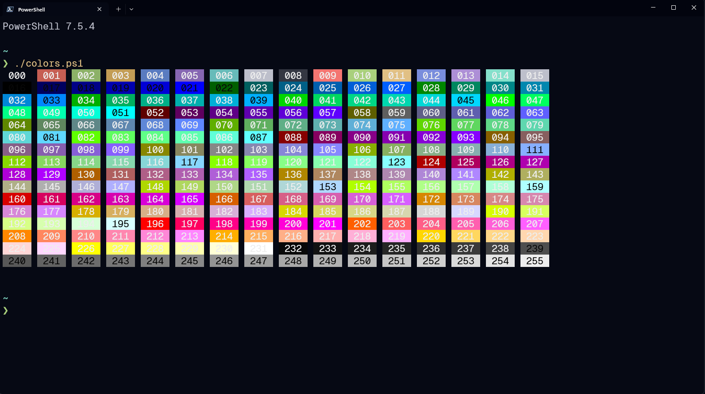
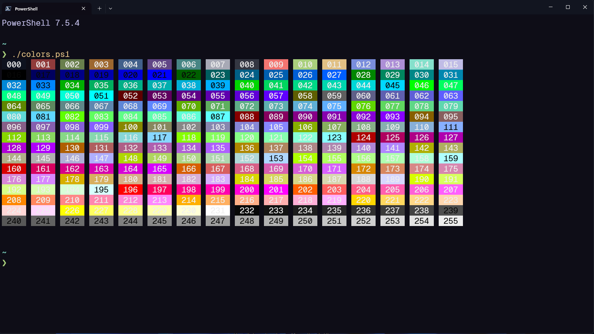
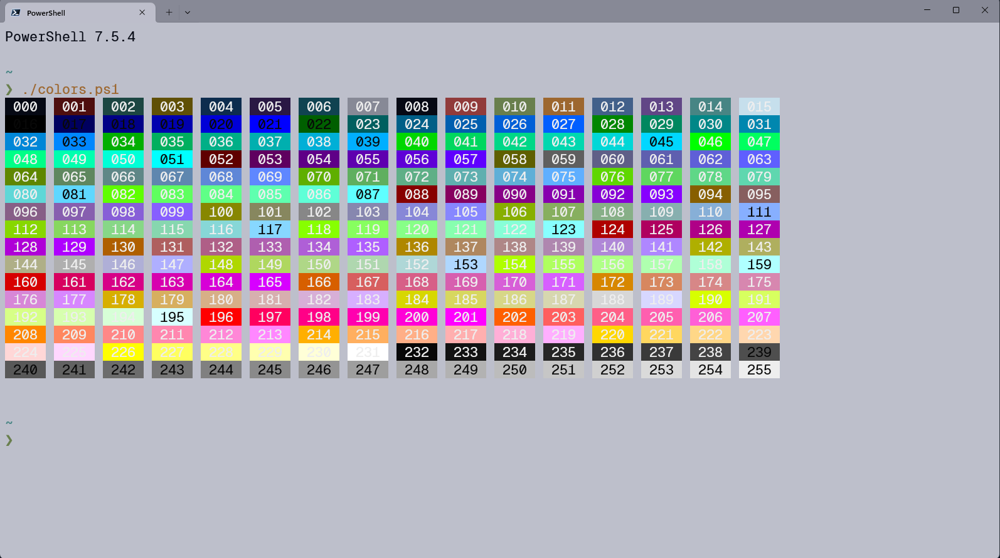
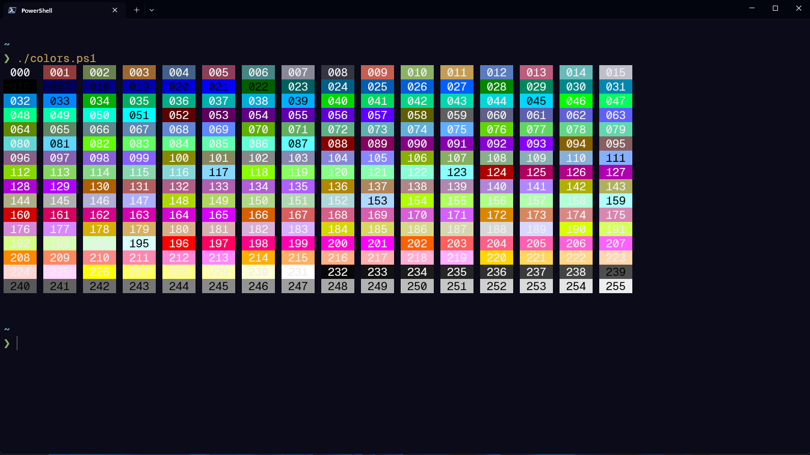

<h1 align="center" valign="middle">
  
  yorumi for windows terminal - deep code, quiet sea
</h1>

  A calming deep sea colorscheme for developers, crafted for <strong>Windows Terminal</strong>.

---

Yorumi keeps visual noise low with mellow, low-contrast UI component backgrounds while text and syntax stay sharp: body text measures 9.6-19.5:1 against its background (WCAG AAA), and the lowest-contrast syntax token is 5.6:1 (WCAG AA).

## Theme Showcase

> [!WARNING]  
> Yorumi Mist and Shade are replaced by `bifrost` and `ryujin` which offer similar color palette. \
> Other themes such as `cosmic`, `kabocha` and `ether` are not showcased yet. \
> The showcase images are currently outdated and will be replaced with new images.

<table>
  <tr>
    <td align="center" width="50%"> <code>Yorumi Abyss</code></td>
    <td align="center" width="50%"> <code>Yorumi Kraken</code></td>
  </tr>
  <tr>
    <td align="center" width="50%"> <code>Yorumi Mist</code></td>
    <td align="center" width="50%"> <code>Yorumi Shade</code></td>
  </tr>
</table>

## Manual Installation

Open Windows Terminal &rarr; **Settings** (`Ctrl + ,`) &rarr; **Open JSON file** (bottom left), then pick one:

> [!WARNING]  
> This section does not cover adding yorumi-<flavour>-theme.json, since it isn't supported for now

| Option       | Instructions                                                                                  |
| ------------ | --------------------------------------------------------------------------------------------- |
| One flavour  | Copy the contents of `yorumi-<flavour>.json` and paste them into the `"schemes"` array.       |
| All flavours | Copy the entries from the `"schemes"` array in `yorumi.json` into your own `"schemes"` array. |

Separate entries with commas. Save, then choose it under **Settings &rarr; Profiles &rarr; Defaults &rarr; Appearance &rarr; Color scheme**.

## Accessibility
Body text measures 9.6-19.5:1 against the background (WCAG 2.1 AAA); every palette token clears 5.6:1 (AA). No blanket AAA claim is made for syntax colours - sRGB runs out before the saturated hues get lighter.
