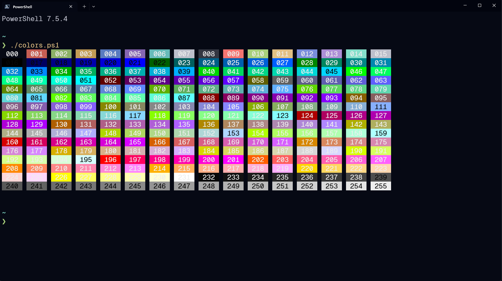
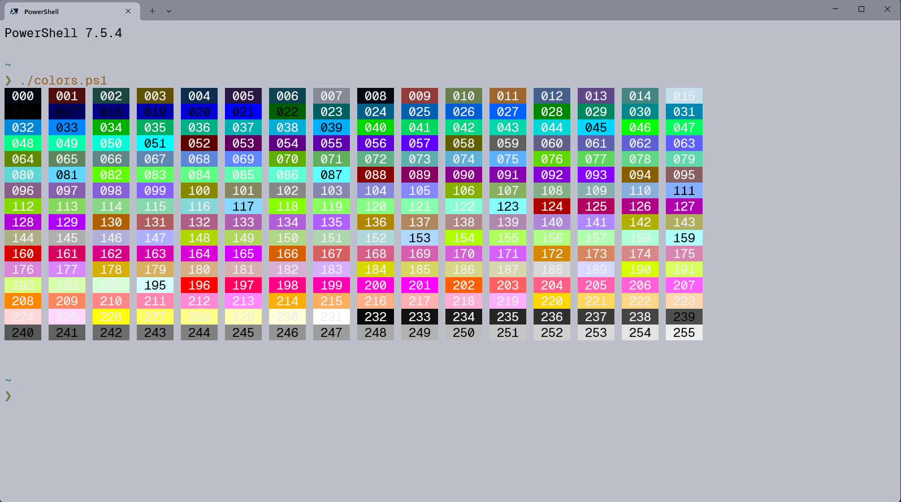
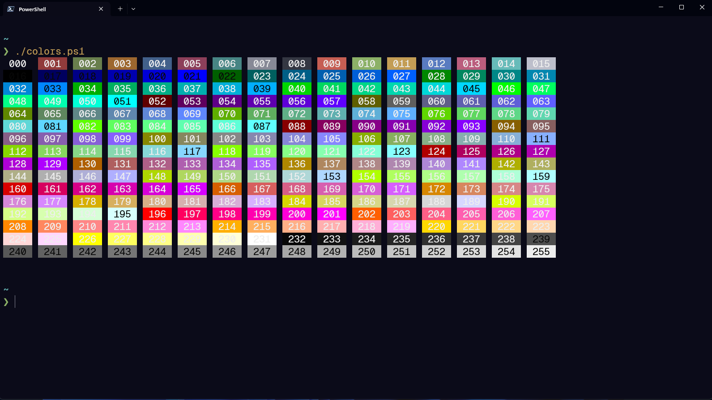
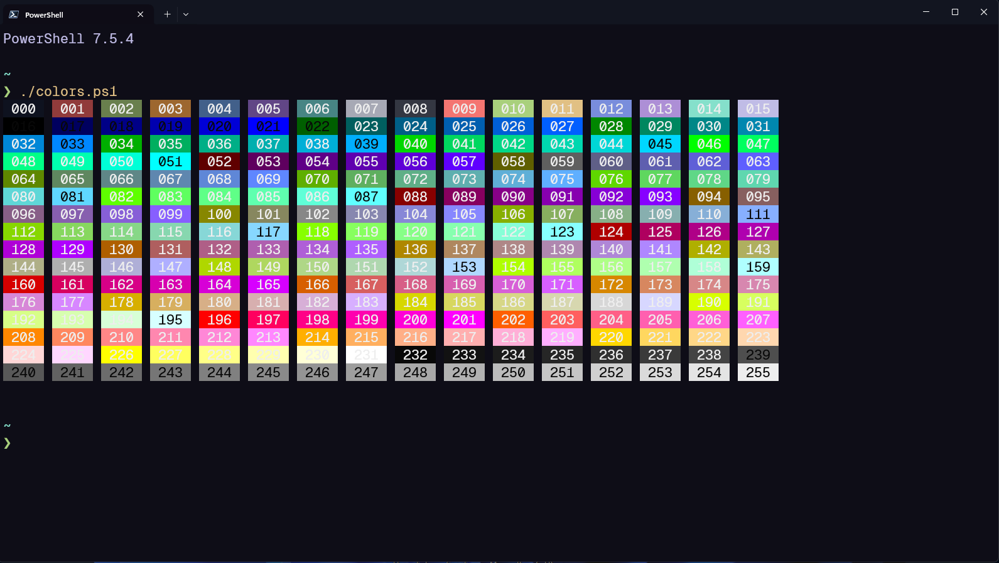

# Yorumi themes for Windows Terminal

|  |  |
| --- | --- |
| Yorumi Abyss | Yorumi Mist |
|  |  |
| Yorumi Shade | Yorumi Kraken |


### Installation

# Individual theme usage
In Windows terminal, open the Settings panel (Ctrl + ,), and select **Open JSON file** at the bottom left corner (Ctrl + Shift + ,). Then, choose your flavour (abyss, mist, shade, kraken) and copy the contents of the corresponding `yorumi-[flavour].json` into the `"schemes"` section of the JSON file. Similarly, copy the contents of the corresponding `yorumi-[flavour]-theme.json` into the `"themes"` section.

# Collective themes

To access all of the themes (and colorschemes) to try them all out, copy the single `yorumi.json` file with `schemas` and `themes` sections.

```jsonc
{
  "schemes": [
    // yorumi-[Options: abyss | mist | shade | kraken].json
    // or all of the options with copying yorumi.json
  ],
  "themes": [
    // yorumi-[Options: abyss | mist | shade | kraken ]-theme.json
    // or all of the options with copying yorumi.json
  ]
}
```

### Applying the theme

After updating the `settings.json` file, save and exit. In the Settings panel, under **Profiles**, select the profile you want to apply the theme to (or choose **Defaults** to apply it to all profiles). Then, go to **Appearance** and select your desired Yorumi flavour from the **Color scheme** dropdown menu. Click **Save**, and enjoy your new colorscheme.
